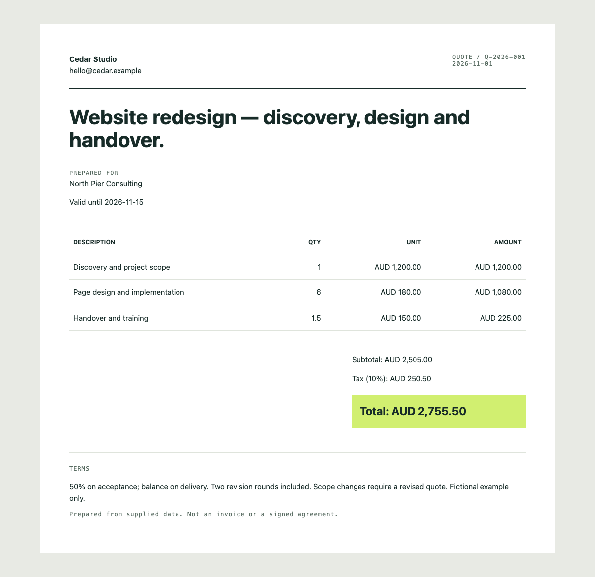

# Two client quotes, independently checked

For a freelancer or small studio preparing a website project and a support engagement. [Brief](request.md) · [Input](input.json) · [Generated documents](output) · [Calculation report](output/report.json)



Expected arithmetic:

| Quote | Subtotal | Tax | Total |
| --- | ---: | ---: | ---: |
| Q-2026-001 | AUD 2,505.00 | AUD 250.50 | AUD 2,755.50 |
| Q-2026-002 | AUD 1,200.00 | AUD 120.00 | AUD 1,320.00 |

```sh
python3 scripts/quotes.py examples/freelance-quotes/input.json --out output/my-quotes
```

Open the resulting index.html locally. HTML is editable; JSON exposes every calculation. Names, prices, tax rates and work are fictional. Tax treatment and client approval are not verified.
